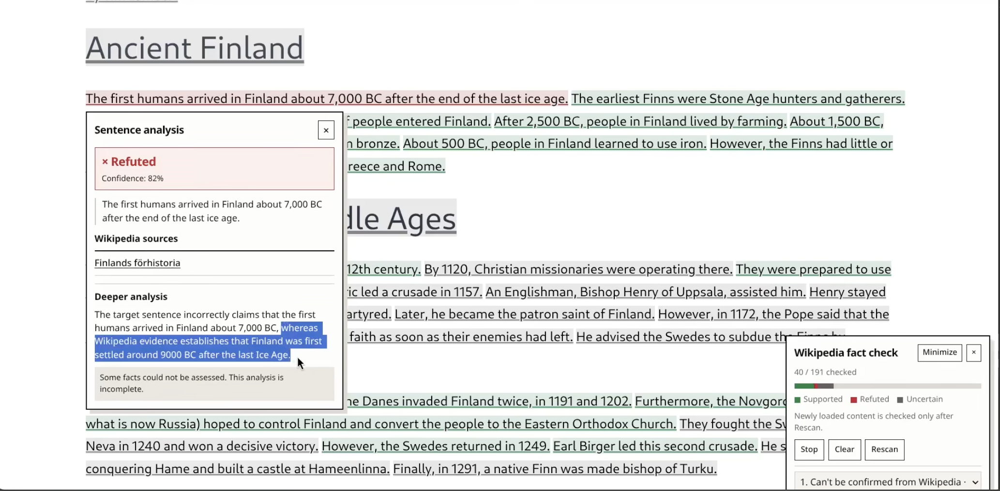
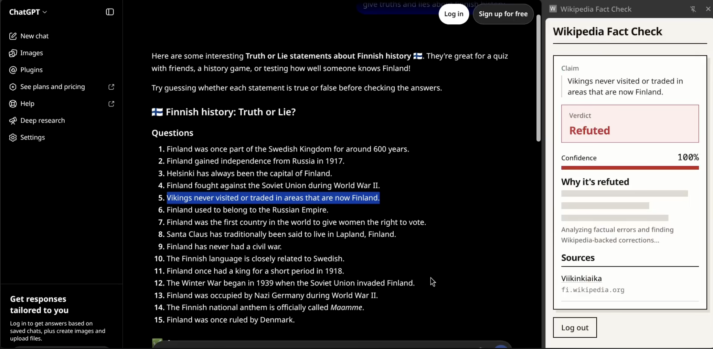

# Wikipedia Fact Check

Check what you read against Wikipedia. Wikipedia Fact Check is a Chrome extension and website
that takes a claim, a selected passage or a whole article, looks for the closest Wikipedia
text, and tells you whether Wikipedia **supports** it, **refutes** it, or doesn't say
enough to tell. Every verdict links to the Wikipedia articles it is based on, and a refuted
claim comes with the specific errors and the correct facts.

> **Demo video:** [Watch the walkthrough on YouTube](https://www.youtube.com/watch?v=O3tUwFCUzTM)

## What it does

- **Scan a whole article.** Right-click a page and choose **Fact-check this page**. The
  extension extracts the article text and checks it sentence by sentence. Each sentence is
  highlighted as it is answered: green for supported, red for refuted, gray for uncertain.
  The page's own text and layout are left untouched.
- **Check a selection.** Select text, right-click and choose **Fact-check selection** to get a
  verdict, a confidence level and sources in the side panel.
- **See why.** Click a sentence for the deeper analysis: the exact Wikipedia quotes behind the
  verdict and, for refuted claims, each incorrect phrase with an explanation and the correct fact.
- **Use it without installing anything.** The website checks a claim you type or paste, with
  no login.
- **Works in Finnish, Swedish and English.** The explanation is written in the claim's language.
- **Stays within its sources.** The model sees only the retrieved Wikipedia text. It currently
  covers _History of Finland_ articles in all three languages and a set of English Wikipedia
  articles, so claims outside that data get "not enough information" instead of a guess.

| Page scan | Side panel |
| --------- | ---------- |
|  |  |

## How it is built

| Directory    | What                                                              |
| ------------ | ----------------------------------------------------------------- |
| `extension/` | Chrome extension (Manifest V3): page scan, side panel, overlay    |
| `web/`       | Public website (nginx, no login); forwards `/api/` to the backend |
| `backend/`   | Django API: fact check, explanations, accuracy report             |
| `rag/`       | Retrieval layer (`wikirag`): ingestion and vector search          |
| `data/`      | Local RAG data and indexes (git-ignored, never committed)         |

The extension and the website call the same Django API. The backend embeds the claim,
retrieves matching Wikipedia text with MariaDB Vector, and asks a Gemini model to decide from
that text only. The next section describes the steps.

## Getting started

```bash
docker compose up --build        # backend at http://localhost:8000/api/health/, website at http://localhost:8080
```

You need `GEMINI_API_KEY` in `backend/.env` and the RAG data loaded ([rag/README.md](rag/README.md)).
To use the extension, open `chrome://extensions`, enable **Developer mode**, choose
**Load unpacked** and select the `extension/` folder. See [extension/README.md](extension/README.md)
and [web/README.md](web/README.md) for details.

See [AGENTS.md](AGENTS.md) for setup and contribution conventions.

## How a check works

1. The claim (for page scans, the sentence plus a little page context) is embedded with
   bge-m3 through Ollama.
2. MariaDB Vector finds the closest Wikipedia text in two datasets: _History of Finland_
   articles in Finnish, Swedish and English, and 500,000 paragraphs of English Wikipedia.
   The two rankings are merged into the 3 best articles. See [rag/README.md](rag/README.md).
3. `gemini-decision-1` decides SUPPORTED, REFUTED or NOT ENOUGH INFO from those articles only,
   and rates which articles bear on it; those become the sources.
4. On request, `GEMINI_EXPLAIN_MODEL` quotes the evidence and, for refuted claims, lists each
   factual error with the correct fact.

The model sees only the retrieved text, so claims about topics outside the data should get
NOT ENOUGH INFO rather than a guess. Results further than cosine distance 0.5 are not passed on.

| Endpoint                         | Used by                                                                                   |
| -------------------------------- | ----------------------------------------------------------------------------------------- |
| `POST /api/factcheck/`           | extension selection checks (password)                                                     |
| `POST /api/factcheck/batch/`     | extension page scans, streamed (password)                                                 |
| `POST /api/factcheck-ratelimit/` | website and extension selection checks without a password, one request per second overall |
| `GET /accuracy`                  | accuracy report (below)                                                                   |

## Accuracy report

`/accuracy` is a read-only report of the 100 true and 100 false statements in
`backend/factcheck/benchmark/`. It uses the same verdict and correction functions as the
extension. File labels are used only for scoring, never included in the model input.

Run the evaluation explicitly, once, after loading the RAG data and configuring
`GEMINI_API_KEY` in `backend/.env`:

```bash
docker compose exec backend python manage.py run_accuracy
```

Every attempt is saved before calling the model. Repeating this command refuses to run.
`--resume` processes only statements never attempted, skipping interrupted or failed calls;
`--rerun` explicitly authorizes a fresh evaluation and archives the previous result. A
correction is requested once for each refuted verdict. The fifth column shows the existing
deeper analysis's combined explanation and correction, with Wikipedia links.

Results live beside the Django database (`backend/accuracy-results.json` locally,
`/data/accuracy-results.json` in production), overridable with `ACCURACY_RESULTS_PATH`.
Keep the local `backend/accuracy-results.json` with the source when deploying the report:
the Docker image includes it as a read-only fallback when the production volume has no
saved run. Existing volume results take precedence. Page loads, deployments, and backend
startup never invoke the evaluation; the report has no run endpoint or browser scripts.

SUPPORTED is the positive class. Overall accuracy counts abstentions and failed/interrupted
attempts as incorrect; precision, recall, F1, and specificity use decisive verdicts only.
Abstentions, coverage, and failed-check counts are shown separately.
